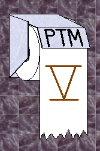
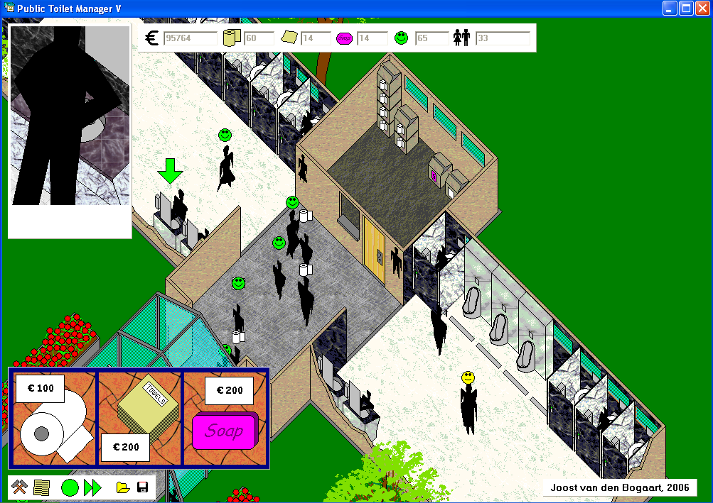

# Public Toilet Manager

Public Toilet Manager is a game in which you build and run
a public toilet. It is one of
[Richèl Bilderbeek's games](https://richelbilderbeek.github.io/games)
and was made by Joost van den Bogaart.
You can [play it in your browser](play.md).





## Building the game

The game was originally written in C++Builder 6 using the VCL
(`PTM5Beta.bpr`).
There is also a Qt version (`publictoiletmanager.pro`), which is built
by continuous integration:

- [The Linux build script](https://github.com/richelbilderbeek/publictoiletmanager/blob/master/.github/workflows/build_linux.yaml)
  checks that the game builds on Linux
- [The Windows build script](https://github.com/richelbilderbeek/publictoiletmanager/blob/master/.github/workflows/build_windows.yaml)
  creates a zip file with the Windows executable,
  which can be downloaded from the workflow run

To build the Qt version locally:

```bash
mkdir build
cd build
qmake ../publictoiletmanager.pro
make
```

## License

Public Toilet Manager is free software,
licensed under the [GPL-3.0](https://github.com/richelbilderbeek/publictoiletmanager/blob/master/LICENSE).
