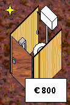
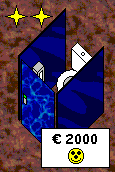
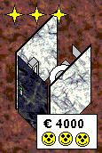
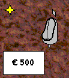
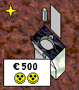
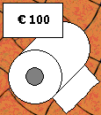
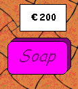
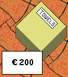

# How to play

You start with € 5000.
Build toilets, keep them clean and stocked,
and earn money from your customers.

## Building

Click the build button to open the build panel,
then click an empty spot to build.

| Building                                    | Name              | Price  |
|---------------------------------------------|-------------------|--------|
|             | Basic toilet      | € 800  |
|       | Standard toilet   | € 2000 |
|           | Luxury toilet     | € 4000 |
|                  | Urinal            | € 500  |
|                      | Sink              | € 500  |

Better toilets make your customers happier.

## Supplies

Click the order button to open the order panel.

| Supply                            | Name          | Price per 10 |
|-----------------------------------|---------------|--------------|
|     | Toilet paper  | € 100        |
|              | Soap          | € 200        |
|          | Towels        | € 200        |

## Cleaning

Click a toilet to clean it:

- Cleaning a toilet costs € 10, and refills its toilet paper when needed
- Cleaning a urinal costs € 5
- Refilling a sink costs € 5, using soap and towels from your stock

## Controls

- Arrow keys: scroll the view
- Status bar: shows your money, stock, rating and number of customers
- Use the buttons to change the speed, or to save and load a game
